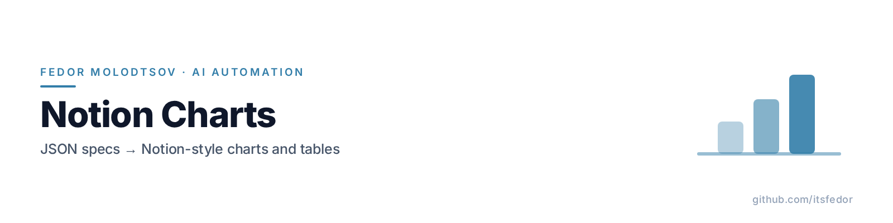
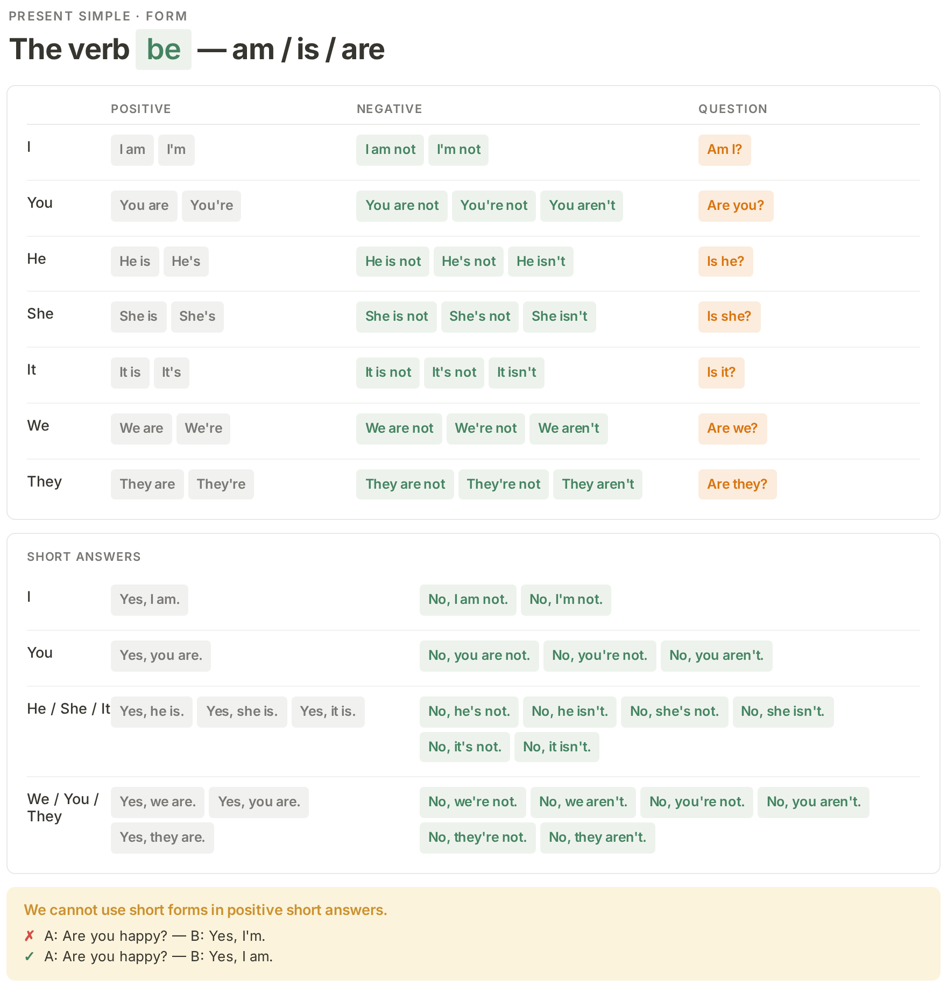
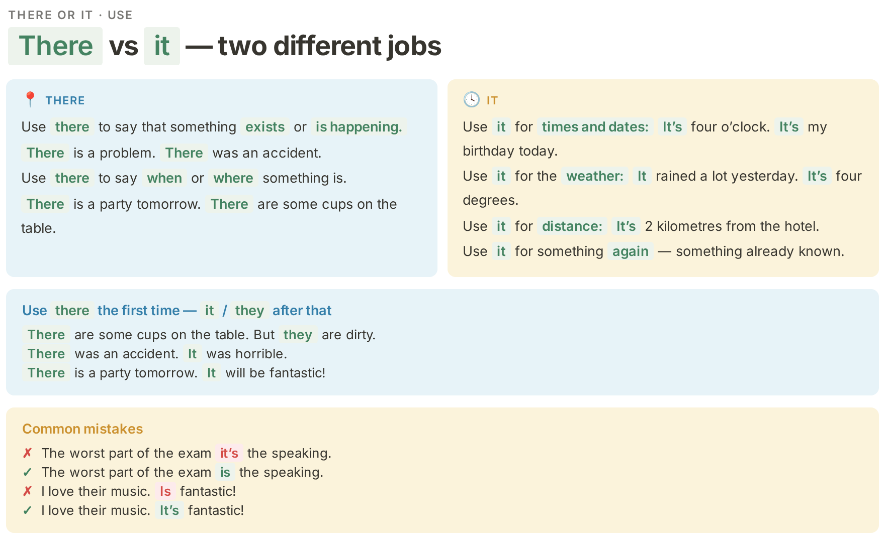
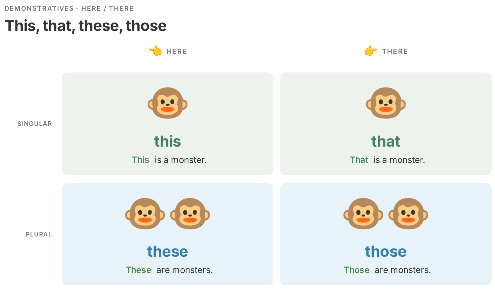

<picture>
  <source media="(prefers-color-scheme: dark)" srcset="assets/banner-dark.png">
  
</picture>

<p align="center"><sub><b>Fedor Molodtsov</b> — AI automation engineer · <a href="https://github.com/itsfedor">github.com/itsfedor</a></sub></p>

# Notion Charts

[](LICENSE)
[](https://www.python.org)
[](https://playwright.dev)

Turn a small JSON spec into a Notion-style chart: transparent canvas, Inter
type, the pastel Notion palette, a 2× PNG, QA-checked. Made for course and
lesson materials where a chart has to look designed, not clip-arted.

Used in production for the grammar-chart waves of a 187-lesson ESL course
(600+ chart images produced through this pipeline).

## Gallery







## Quickstart

```bash
python3 -m pip install playwright
python3 -m playwright install chromium

python3 render_one.py examples/be-form.spec.json out.png    # html + 2x PNG + QA
```

`render_one.py` writes `out.html` next to the PNG, renders `.chart` at
deviceScaleFactor 2 (a ~1760px-wide transparent PNG) and prints a QA JSON:
root size, fonts loaded, overflow list, element counts. **Exit code 2 means
overflow or a font did not load — fix the spec and re-render.** Run it from
the repo root so its imports and `base.css` resolve.

Or in two steps:

```bash
python3 chartgen.py spec.json out.html          # spec -> HTML
python3 render_chart.py out.html out.png --width 920
```

## The spec

```json
{
  "eyebrow": "Present simple · form",
  "title": "The verb **be** — am / is / are",
  "blocks": [ ... ]
}
```

Rich-text markers work in any text value: `**green**` · `~~red~~` ·
`__blue__` · `==gray==`. Blocks: `table` (cells split into pills with
`a|b|c`), `cards`, `pills`, `note` (✓ / ✗ callout), `list`, `illustration`
(quadrant scenes with big figures), `images`. Nine pastel colours to choose
from. Full reference: [docs/spec-reference.md](docs/spec-reference.md).

## Pieces

| File | What it does |
|---|---|
| `chartgen.py` | Spec → HTML. The layout engine (tables, cards, notes, illustration matrices) |
| `render_chart.py` | Playwright renderer: element screenshot at 2×, `omit_background=True`, QA probe |
| `render_one.py` | One command: spec → HTML → PNG → QA JSON. The one to use |
| `base.css` | The Notion-light token set: text `#37352F`, hairlines `#E9E9E7`, nine pastel tints, no shadows, transparent body |
| `tools/ocr_charts.py` | Transcribe a source chart without a vision model: every text line with position and dominant colour |
| `tools/color_map.py` | Coarse letter-grid map of a chart image: where the boxes, chips and panels sit |
| `examples/` | Three calibration specs with their 2× renders |

## Rebuilding an existing chart

If the chart already exists as an image (a textbook scan, a screenshot), the
pipeline reads it without a vision model and rebuilds it in the house style.
See [docs/redesign-workflow.md](docs/redesign-workflow.md).

## License

AGPL-3.0. See [LICENSE](LICENSE). If AGPL does not fit your use case, a commercial license is available — [COMMERCIAL.md](COMMERCIAL.md).
